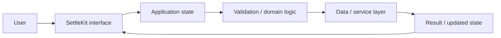
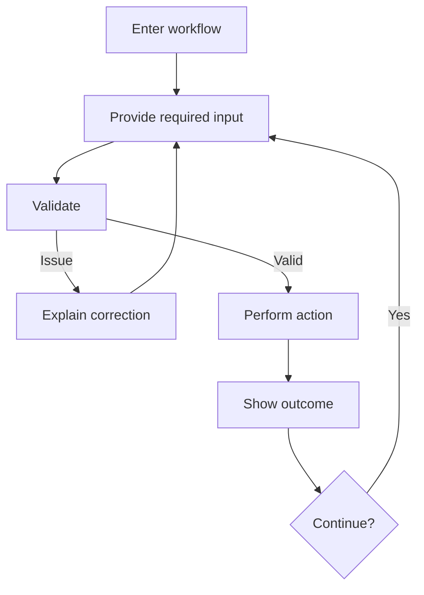
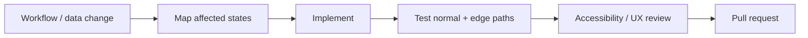

<div align="center">

# SettleKit

**A product-oriented web project documented around its interface, workflow, application logic, user states, and maintainable delivery structure.**


[Browse source](https://github.com/Nischhalsubba/settlekit/tree/main) · [Issues](https://github.com/Nischhalsubba/settlekit/issues)

</div>

## Overview

**SettleKit** is documented so the product can be understood without starting from framework internals. The key model is user intent → interface → validation/application logic → data or service interaction → visible outcome.

<details open>
<summary><strong>🏗️ Interactive product architecture</strong></summary>



</details>

## Product flow



## Audience guide

| Audience | Focus |
|---|---|
| Users | Clear tasks, feedback and outcomes |
| Developers | State, rules, data/service boundaries and tests |
| Designers | Workflow hierarchy, edge states and responsive behavior |
| Product / QA | Requirements, success criteria and failure recovery |

## Getting started

```bash
git clone https://github.com/Nischhalsubba/settlekit.git
cd settlekit
```

Use the repository's manifests and lockfiles to determine the current runtime, package manager, and commands.

## Design & accessibility

Make states visible, errors actionable, destructive actions explicit, focus keyboard-visible, layouts responsive, and loading/empty/success states purposeful. Avoid hidden system behavior that requires users to infer whether anything happened.

## SEO & discoverability

For public pages, use product-specific terminology that accurately describes SettleKit's implemented purpose. Maintain descriptive titles and metadata, semantic headings, meaningful links, canonical URLs, and social-preview content; authenticated/private application screens should prioritize security and task clarity over indexing.

## Contribution flow


